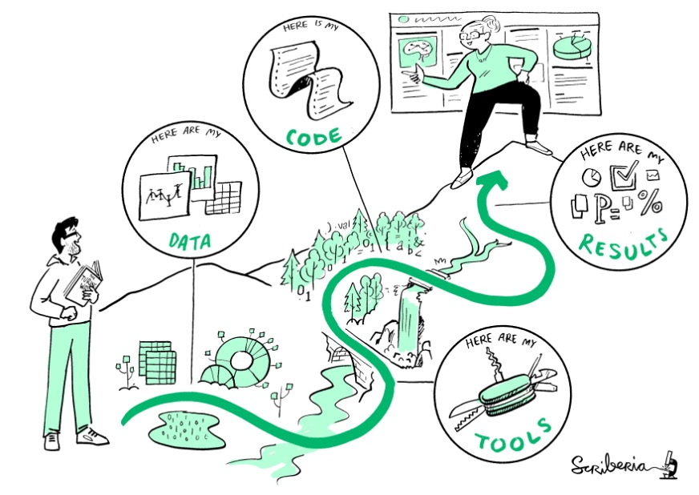

:::::::::::::::::::::::::::::::::::::: questions 

- Are FAIR and open the same?
- What is research integrity?
- What is the relationship between FAIR, open and research integrity?

::::::::::::::::::::::::::::::::::::::::::::::::

::::::::::::::::::::::::::::::::::::: objectives

- Define FAIR
- Define Open Science
- Define research integrity
- Describe synergies between FAIR, Open Science and Research Integrity

::::::::::::::::::::::::::::::::::::::::::::::::

## Introduction

To be added

:::::::::::::::::::::::::::::::::::::::::::::::::::::::::::::::::::: instructor

Inline instructor notes can help inform instructors of timing challenges
associated with the lessons. They appear in the "Instructor View"

::::::::::::::::::::::::::::::::::::::::::::::::::::::::::::::::::::::::::::::::

::::::::::::::::::::::::::::::::::::: challenge 

## Think, Pair, Share - What is FAIR?

This activity should take 10 minutes

In pairs:
- spend 2 minutes thinking about what FAIR means to you
- spend 5 minutes discussing with your partner
- share back your definition to the group
  
::::::::::::::::::::::::::::::::::::::::::::::::

## What is FAIR

The FAIR principles, first published in 2016, contain guidelines for good data management practice that aim at making data FAIR: 

- Findable
  - data can be discovered by both humans and machines
- Accessible
  - data are archived in long-term storage and can be made available using standard technical procedures.
- Interoperable
  - data can be exchanged and used across different applications and systems — also in the future, for example, by using open file formats. It also means that the data can be integrated with other data from the same research field or data from other research fields.  
- Reusable
  - data are well documented and curated and provide rich information about the context of data creation. The data should conform to community standards and include clear terms and conditions on how the data may be accessed and reused, preferably by applying machine-readable standard licences.

There are several[guiding principles](https://www.gofair.foundation/fair-principles), alongside the 4 overarching principles. 

In the context of FAIR data is defined as all kinds of digital objects that are produced in research: research data in the strictest sense, code, software, presentations, etc.

Source:[How to FAIR](https://www.howtofair.dk/what-is-fair/)

Explore:[A FAIRyTale](https://forskningsdata.dk/fairytale/index.html)

## What is Open Science?

Unesco defines Open Science as:

“An inclusive construct that combines various movements and practices aiming to make multilingual scientific knowledge openly available, accessible and reusable for everyone, to increase scientific collaborations and sharing of information for the benefits of science and society, and to open the processes of scientific knowledge creation, evaluation and communication to societal actors beyond the traditional scientific community.”

[UNESCO Recommendation on Open Science](https://www.unesco.org/en/open-science/about)

This can be supported through a range of practices:

The Turing Way project illustration by Scriberia. Used under a CC-BY 4.0 licence. DOI: [The Turing Way Community & Scriberia (2024)](https://doi.org/10.5281/ZENODO.3332807).

::::::::::::::::::::::::::::::::::::: discussion 

## Discussion - Similarities and differences between Open Science and FAIR

::::::::::::::::::::::::::::::::::::::::::::::::

::::::::::::::::::::::::::::::::::::: callout

FAIR is not equal to Open

They are sometimes used to emphasise particularly important points
but are also used in some lessons to present "asides": 
content that is not central to the narrative of the lesson,
e.g. by providing the answer to a commonly-asked question.

::::::::::::::::::::::::::::::::::::::::::::::::

## Research Integrity

::::::::::::::::::::::::::::::::::::: discussion 

## Discussion - How does FAIR and Open science support research integrity?

This activity should take 10 minutes

In pairs:
- spend 2 minutes thinking about what FAIR means to you
- spend 5 minutes discussing with your partner
- share back your definition to the group
::::::::::::::::::::::::::::::::::::::::::::::::

::::::::::::::::::::::::::::::::::::: keypoints 

- Use `.md` files for episodes when you want static content
- Use `.Rmd` files for episodes when you need to generate output
- Run `sandpaper::check_lesson()` to identify any issues with your lesson
- Run `sandpaper::build_lesson()` to preview your lesson locally

::::::::::::::::::::::::::::::::::::::::::::::::

